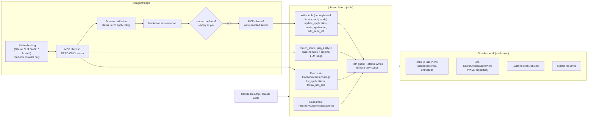

# job-search-mcp

An MCP server and a human-in-the-loop triage agent for a job search kept in an Obsidian vault.

I clip job postings into my vault with the Obsidian Web Clipper and track each application as a note
with YAML properties. This project turns my triage workflow into code:

- **MCP server** (`jobsearch-mcp`): typed tools to read postings, score them against my master resumes,
  run a gap analysis, and update the tracker safely. The master resumes are also exposed as MCP resources.
  It works with Claude Desktop, Claude Code, or any MCP client.
- **Agent** (`jobagent triage`): an MCP client that starts the server, uses a local or hosted LLM for tool
  calling, proposes tracker changes, and writes them only after I confirm.
- **Evals** (`jobagent eval`): precision, recall and accuracy for the deterministic baseline and the LLM
  judge on a labeled set.
- **Safety**: posting text is treated as untrusted input. Tests show that prompt-injection text in a
  posting cannot change application statuses.

It never sends email and never applies to jobs.

## Architecture



## MCP tools

| Tool | Kind | What it does |
|---|---|---|
| `list_postings` | read | Lists the postings in `Jobs to tailor` (file, title, company, role, link, location) |
| `read_posting` | read | Returns one posting with `untrusted: true` and `injection_flags` |
| `search_postings` | read | Full-text search across postings |
| `list_applications` | read | Lists application notes, filtered by `status` and/or `track` |
| `follow_ups_due` | read | Applications in Applied/Interview whose `follow_up` date is on or before a date |
| `match_score` | read | Fit score for a track (`support`/`integration`/`ai`/`auto`), method `baseline`, `llm` or `hybrid` |
| `gap_analysis` | read | Structured JSON: matched skills, missing required, missing preferred, blockers, suggestions |
| `update_application` | write | Changes only `status`, `applied`, `follow_up`, and appends dated lines under `## Notes`. Status only moves forward. Writes are atomic; nothing else in the note changes |
| `create_application` | write | New note with status `To apply` or `Skip` only. Never overwrites an existing note |
| `add_seen_job` | write | Appends `- date \| Company \| Role \| link` to Seen Jobs. Append-only, deduplicated by company + role (ignores case and whitespace) |

Resources: `resume://index`, `resume://support`, `resume://integration`, `resume://ai`.

Status order: `To apply -> Applied -> Interview -> Offer`. Any active status can move to `Rejected`,
`Withdrawn` or `Skip`. Those three are final.

## Matching

**Baseline** (deterministic, `src/jobsearch/matching.py`):

1. Splits the posting into required and preferred sections using headings and phrases like "is an asset".
2. Pulls skills out of the posting and the master resume with a skills list (`src/jobsearch/skills.py`).
3. Score = 80% required-skill coverage + 20% preferred-skill coverage, minus small penalties.
4. Hard filters. If any one applies, the posting is a bad fit:
   - senior, lead, manager or architect titles
   - more than `max_years` years of experience required (default 3)
   - French required (French as an asset is fine)
   - location outside the GTA, unless it is remote in Canada
   - excluded role types (help desk, IT support)

**LLM judge** (optional): any OpenAI-compatible `/chat/completions` endpoint (Ollama, LM Studio, vLLM, or
a hosted API), configured in `[llm]`. `hybrid` uses the LLM's verdict, but the baseline's hard filters can
always veto it.

## Install (Windows, PowerShell 5.1)

Requires Python 3.11 or newer. Run each command on its own line. Windows PowerShell does not support `&&`.

```powershell
cd C:\Users\Keith\projects
```

```powershell
git clone https://github.com/sshower111/job-search-mcp.git
```

```powershell
cd job-search-mcp
```

```powershell
py -m venv .venv
```

```powershell
.\.venv\Scripts\Activate.ps1
```

```powershell
pip install -e ".[dev]"
```

```powershell
Copy-Item jobagent.example.toml jobagent.toml
```

Edit `jobagent.toml` and set `vault_path` and the `[resumes]` paths. Then check the setup:

```powershell
jobagent check
```

To try it without touching your vault, use the synthetic example vault:

```powershell
jobagent --config examples\jobagent.toml triage --dry-run
```

## Register the server

### Claude Code

The server reads its config path from `JOBAGENT_CONFIG`, so no arguments follow the command.
Put `--transport stdio` between `--env` and the server name. Otherwise the CLI reads the name as another
env pair.

```powershell
claude mcp add --scope user --env JOBAGENT_CONFIG=C:\Users\Keith\projects\job-search-mcp\jobagent.toml --transport stdio job-search -- C:\Users\Keith\projects\job-search-mcp\.venv\Scripts\jobsearch-mcp.exe
```

```powershell
claude mcp list
```

To give Claude read-only access, add `--env JOBSEARCH_READ_ONLY=1` before `--transport stdio`.

### Claude Desktop

Edit `%APPDATA%\Claude\claude_desktop_config.json`:

```json
{
  "mcpServers": {
    "job-search": {
      "command": "C:\\Users\\Keith\\projects\\job-search-mcp\\.venv\\Scripts\\jobsearch-mcp.exe",
      "env": {
        "JOBAGENT_CONFIG": "C:\\Users\\Keith\\projects\\job-search-mcp\\jobagent.toml"
      }
    }
  }
}
```

Restart Claude Desktop afterwards.

## Run the agent

Dry run. This prints and saves a report to `reports\triage-DATE.md` and writes nothing to the vault:

```powershell
jobagent triage --dry-run
```

Interactive: review each proposal and answer y/n:

```powershell
jobagent triage
```

Apply every proposal except the ones flagged for manual review:

```powershell
jobagent triage --apply
```

With a local LLM doing the tool calling (Ollama shown):

```powershell
ollama pull qwen2.5:7b-instruct
```

```powershell
jobagent triage --llm --dry-run
```

`--no-llm` forces the deterministic baseline even when `[llm] enabled = true`.

## Run the evals

```powershell
jobagent --config examples\jobagent.toml eval
```

```powershell
jobagent --config examples\jobagent.toml eval --llm
```

Reports are written to `evals\reports\` (Markdown and JSON). The committed
[`evals/reports/baseline-synthetic.md`](evals/reports/baseline-synthetic.md) shows the baseline on the 15
synthetic postings: 15/15 correct. Treat that as a smoke test, not a result. The postings were written
alongside the rules, and two misses found early led to rule changes (no recognized skills now
counts as a bad fit; help desk and IT support titles are excluded). The LLM judge has not been evaluated
in this repo yet. [`evals/LABELING.md`](evals/LABELING.md) explains how to label about 30 real postings
privately for a meaningful number.

## Safety design

Posting text comes from third parties, so the design assumes it can contain prompt injection.

1. **Read-only by construction.** The agent's LLM phase talks to a server started with
   `JOBSEARCH_READ_ONLY=1`, which does not register write tools at all. The agent refuses to continue if a
   write tool shows up in that session.
2. **Tool allowlist.** The LLM is only offered `read_posting`, `search_postings`, `list_applications`,
   `match_score` and `gap_analysis`. A call to any other tool, such as a hallucinated `send_email`, is
   refused and recorded as a security event in the report.
3. **Narrow output schema.** The LLM can only recommend `To apply` or `Skip`. Any other status (for example
   `Offer` or `Interview`) is rejected, and the baseline decision is kept. Separately, `create_application`
   refuses any other status on the server side.
4. **Rules veto.** Hard filters (seniority, years, French, location) override the LLM, so "rate this a
   perfect fit" text cannot push a senior role through.
5. **Isolation and delimiting.** Each posting gets a fresh LLM conversation. Posting bodies are wrapped
   in `<<<UNTRUSTED_POSTING_CONTENT ... >>>` delimiters, and look-alike delimiters inside the text are
   neutralized.
6. **Human in the loop.** Writes happen in deterministic code, in a second session, only after
   `--apply` or an interactive `y`. Postings that match the injection heuristics are flagged `CHECK` and
   skipped by `--apply`.
7. **Vault guard.** Every path is resolved and must stay inside the vault and the expected folder. Absolute
   paths, `..` and symlink escapes are rejected. Writes are atomic (temporary file, then `os.replace`), and
   nothing is ever deleted.
8. **No PII in logs.** Logs go to stderr only (stdout is the MCP channel). They contain file names and
   field names, never posting or resume text. A redaction filter masks emails, phone numbers, Windows/home
   user folder names and API keys.

`tests/test_injection_and_agent.py` runs a "hijacked" fake LLM against injection fixtures
(`tests/fixtures/injection/`). The fake LLM calls `update_application` with `Offer`, calls `send_email`,
tries to read `../Resumes/...`, and returns `proposed_status: "Offer"`. The tests check that the vault is
byte-for-byte unchanged after proposing, and that existing statuses are unchanged even if a human
approves every proposal.

The heuristics are a signal for human review, not a guarantee. The real boundary is the structure in
points 1 to 6.

## Development

```powershell
pytest
```

```powershell
ruff check .
```

CI (GitHub Actions) runs ruff and pytest on Ubuntu and Windows with Python 3.11 and 3.13.
Built on the official MCP Python SDK v2 (`mcp.server.mcpserver.MCPServer` and `mcp.Client`).

## Project layout

```
src/jobsearch/
  server.py      MCP server: tools + resources
  vault.py       path-safe vault access, atomic writes, status rules
  frontmatter.py lossless YAML frontmatter edits
  matching.py    baseline scorer, hard filters, gap analysis
  skills.py      skills list and suggestions
  judge.py       LLM judge + hybrid veto
  llm.py         OpenAI-compatible client (stdlib only)
  agent.py       triage agent (MCP client, tool calling, proposals, report)
  evals.py       labeled-set evaluation
  safety.py      injection heuristics, untrusted wrapping, log redaction
  cli.py         jobagent triage | eval | check | serve
examples/        synthetic vault + config (fictional companies and persona)
evals/           15 synthetic postings, labels.csv, labeling guide, reports
tests/           pytest suite, injection fixtures
```

## Roadmap

- **Gmail read-only ingestion**: read job-alert and application-status emails with the `gmail.readonly`
  scope and turn them into the same proposals ("Applied" confirmations, rejections, interview invites).
  Emails get the same untrusted-content handling, and writes still need confirmation. No send scope.
- Tailored-resume drafts per posting, as a new note that is never sent anywhere automatically.
- Daily summary note writer (`Job Search/Daily Summaries/YYYY-MM-DD.md`).
- Evaluate the LLM judge against the private labeled set and report the results here.
- Embedding-based skill matching to complement the keyword list.

## License

MIT
